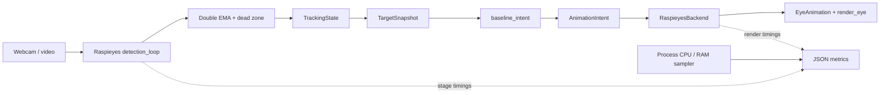
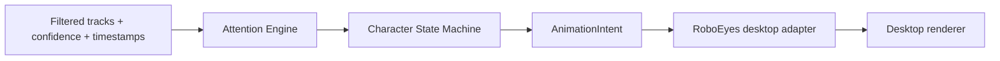

# Laptop experiments — Raspieyes baseline

Các file ở đây thay cho các đoạn Python và shell function tạm thời của bước 5–6. Chạy bằng Python trong environment đã cài tại `raspieyes/.venv`.

## Cài đặt trên máy mới — laptop Ubuntu

`raspieyes/` là dependency tải riêng và được ignore trong repository FaceTracing. Source/model upstream không được commit vào repo chính. Repo chính giữ runner, config, tài liệu và [patch benchmark hooks](../patches/raspieyes-benchmark-hooks.patch) để tái tạo các thay đổi cần thiết.

Sau khi clone FaceTracing, chạy các lệnh sau từ root project. Dùng đúng upstream commit đã kiểm chứng:

```bash
git clone https://github.com/alevizio/raspieyes.git raspieyes
git -C raspieyes checkout --detach 6289af4d6430dcf1107fce94907fa3ee1fd52d7f
git -C raspieyes apply --check ../patches/raspieyes-benchmark-hooks.patch
git -C raspieyes apply ../patches/raspieyes-benchmark-hooks.patch
```

Patch bổ sung observer, detector selection, capture injection và cooperative shutdown mà runner sử dụng. Bản upstream nguyên gốc chưa có các hook này. Các lệnh clone/apply dành cho máy mới; máy hiện tại đã có source được chỉnh sửa thì không cần áp dụng lại patch. Khi cần cập nhật upstream, kiểm chứng lại compatibility trước khi đổi commit cố định.

Tạo environment laptop và cài dependencies:

```bash
sudo apt update
sudo apt install git python3-venv libgl1 libglib2.0-0 libportaudio2
python3 -m venv raspieyes/.venv
raspieyes/.venv/bin/python -m pip install --upgrade pip
raspieyes/.venv/bin/python -m pip install \
  "numpy==1.26.4" \
  "opencv-contrib-python==4.11.0.86" \
  "mediapipe==0.10.21" \
  "pygame==2.6.1"
raspieyes/.venv/bin/python -m pip check
```

Hướng dẫn này dành cho laptop Ubuntu/Python 3.12. Raspberry Pi OS cần kiểm chứng dependencies ARM và camera backend riêng; runner hiện mở USB/webcam bằng V4L2, còn camera CSI cần adapter Picamera2. Raspieyes vẫn là runtime dependency khi giữ pipeline hiện tại.

Không dùng `raspieyes/setup.sh` để thiết lập laptop: script upstream dành cho deployment Raspberry Pi và tạo autostart/systemd.

### Khi chỉnh sửa dependency local

`raspieyes/` bị ignore ở repo cha nên thay đổi trong đó cần được xuất thành patch trước khi commit FaceTracing. Với các file hiện đang được chỉnh sửa, chạy từ root project:

```bash
git -C raspieyes diff --binary HEAD -- eye_renderer.py eye_tracker.py > patches/raspieyes-benchmark-hooks.patch
```

Nếu sửa thêm file khác, bổ sung file đó vào lệnh export. File mới chưa được Git của Raspieyes theo dõi sẽ không tự xuất hiện trong `git diff`. Commit patch cùng thay đổi runner/config liên quan để máy mới tái tạo được cùng pipeline.

`benchmark/` cũng là dữ liệu local bị ignore; các link kết quả trong roadmap/tài liệu chỉ tồn tại trên máy đã chạy, trừ khi chủ động chia sẻ kết quả riêng.

## Luồng code hiện tại



- `run_raspieyes.py`: entry point, cấu hình, nguồn camera, worker perception, vòng render, shutdown và ghi JSON.
- `config.json`: thay đổi tham số ở đây thay vì sửa một chuỗi lệnh dài.
- `raspieyes_adapter.py`: điểm nối giữa target đã lọc và animation. `TargetSnapshot` chứa tọa độ chuẩn hóa, trạng thái, face width và timestamp. `AnimationIntent` mô tả hành vi/gaze ở mức animation, không phải pixel của màn hình.
- `metrics.py`: đo process CPU/RAM, thống kê latency và lưu JSON nguyên tử.
- `../raspieyes/eye_renderer.py`: vẫn thực hiện detector và filtering gốc. Bổ sung hook observer, explicit detector, motion-fallback switch, capture factory và stop event. Vòng detection không dùng centroid/Kalman tracker; EMA hiện tại chưa phải tracking nhiều người có ID.

`baseline_intent()` hiện chỉ chuyển trạng thái `detected` thành `follow`, còn lại thành `idle`. Đây là adapter baseline, chưa phải Attention Engine hoặc Character State Machine tương tác.

## Khi ghép RoboEyes ở M4–M5



Điểm thay đổi rõ nhất nằm ở vòng foreground của `run_once()`:

```python
# Hiện tại, đã chạy được:
target = TargetSnapshot.from_tracking(tracking)
intent = baseline_intent(target)
backend.render(intent, dt)

# Luồng dự kiến ở milestone sau, chưa triển khai:
# selected = attention.update(tracks, observations, now)
# intent = character.update(selected, events, now)
# roboeyes_backend.render(intent, dt)
```

Không đưa logic detector vào RoboEyes. Attention chọn/giữ target; Character State Machine chọn biểu cảm, blink và timing; backend thực hiện intent. Khi thay backend, vòng inference vẫn hoạt động độc lập. Trước M4 cần bổ sung track/quality/freshness contract của M2–M3; `confidence` của detector hiện nằm trong sample JSON và không được coi là confidence tổng hợp của attention.

RoboEyes gốc là C++ với giao diện display và clock kiểu Arduino/Adafruit GFX. Desktop adapter cần kiểm chứng riêng, bao gồm vị trí liên tục và timing. Runner hiện vẫn dùng animation của Raspieyes; chưa tích hợp RoboEyes, interaction lock hoặc gaze estimation.

## Chạy bước 5

Từ thư mục `FaceTracing`, chạy trong Terminal desktop:

```bash
raspieyes/.venv/bin/python experiments/run_raspieyes.py --mode mouse
raspieyes/.venv/bin/python experiments/run_raspieyes.py --mode webcam
```

Mouse mode kiểm tra renderer mà không mở camera. Webcam mode dùng camera index đã đặt trong config; có thể đổi bằng `--camera-index 2`.

Mặc định: MediaPipe CPU, capture yêu cầu 640×480/30 FPS, detection target 10 FPS, renderer target 30 FPS, một mắt 640×640, warm-up 5 giây rồi đo 60 giây. Audio không được khởi động. Motion fallback tắt để baseline face không bị trộn với chuyển động nền. Presence timeout được đặt 1 giây thay cho 15 giây gốc và được ghi trong JSON; đây là tham số thử nghiệm, chưa phải release policy cuối cùng.

`Q`, `Esc`, đóng cửa sổ hoặc `Ctrl+C` dừng phiên và lưu kết quả đã có. Mỗi phiên tự tạo JSON có tên duy nhất trong `benchmark/`.

## Chạy bước 6

```bash
raspieyes/.venv/bin/python experiments/run_raspieyes.py --mode benchmark
```

Lần lượt chạy detection target 5, 10, 15 FPS; renderer giữ nguyên theo config. Tất cả run nằm trong **một JSON**. Mỗi run có warm-up riêng; detector/filter reset, camera mở lại và random seed cố định. `Q` hoặc `Ctrl+C` kết thúc cả phiên, không tự chuyển sang run kế tiếp.

Ví dụ phiên ngắn hoặc chọn backend khác:

```bash
raspieyes/.venv/bin/python experiments/run_raspieyes.py --mode benchmark --duration 30 --warmup 5
raspieyes/.venv/bin/python experiments/run_raspieyes.py --mode webcam --detector dnn
raspieyes/.venv/bin/python experiments/run_raspieyes.py --mode webcam --perception-only
```

`--perception-only` chạy cùng perception và sampler nhưng không vẽ mắt: dùng để so sánh chi phí với phiên bật renderer. Explicit detector sẽ báo lỗi nếu backend không chạy được, tránh fallback âm thầm. Chỉ `--detector auto` cho phép đổi backend tự động.

Để thử video ghi sẵn:

```bash
raspieyes/.venv/bin/python experiments/run_raspieyes.py --mode benchmark --video /absolute/path/input.mp4
```

Video được đọc tuần tự, một frame mỗi detection cycle: playback chậm/nhanh theo detection rate, **chưa phải replay realtime theo timestamp video**. Vì vậy dùng để kiểm tra tính đúng và workload; chưa so sánh walk-by/reaction latency giữa các rate như thể cùng tốc độ chuyển động. Video kết thúc trước warm-up được ghi `insufficient_data`.

## JSON chứa gì?

```text
schema_version
environment: CPU, OS, Python, package versions, git commit, patch, checksums
measurement_notes: cách diễn giải và giới hạn số liệu
runs[]
  config: tham số của run
  actual_detector: backend thực sự chạy
  capture: thiết bị, backend, format/FPS do driver báo
  status / stop_reason
  summary: FPS thực tế, CPU/RAM, latency P50/P95/P99
  events[]: khởi động, bắt đầu đo, mất frame, lỗi, EOF
  detection_samples[]: timing, confidence, raw/filtered target, phase
  render_samples[]: intent, render timing, tuổi frame được dùng
  process_samples[]: CPU và RSS lấy mẫu định kỳ
```

JSON được checkpoint mỗi 5 giây và ghi lần cuối khi thoát bình thường/lỗi. Mỗi checkpoint là JSON hợp lệ, ghi vào file tạm rồi replace. Tắt nguồn hoặc `kill -9` chỉ giữ checkpoint cuối, có thể còn `status=running`. Raw image/video và microphone audio không được lưu; warning native EGL/MediaPipe vẫn hiển thị trên Terminal.

[verification_idle.json](../benchmark/verification_idle.json) là output thực của smoke test headless idle để xem cấu trúc file; không có webcam và không dùng làm kết luận hiệu năng M1. Metadata/checksums mô tả phiên đã tạo output đó.

Warm-up, khởi tạo model và shutdown không nằm trong summary steady-state. `null` nghĩa là không có phép đo hoặc không đủ mẫu; không điền FPS/latency giả bằng 0.

| Metric | Cần hiểu đúng |
|---|---|
| `actual_detection_fps` | Số frame detection hoàn thành trong khoảng đo; không phải FPS cấu hình |
| `actual_renderer_fps` | Số lần render/flip hoàn thành; không bảo đảm refresh màn hình vật lý |
| `detection_stage_ms` | Tạo input, model call và chọn face tốt nhất; chưa tách model-kernel-only |
| `detection_calling_thread_cpu_ms` | CPU của thread gọi inference; không tính đủ native worker threads |
| `process_cpu_ms_per_completed_frame` | CPU toàn process/frame, gồm rendering/sampler; không phải CPU inference riêng |
| `host_frame_to_target_ms` | Từ nhận frame tại host đến filtered target; chưa tính exposure/camera buffering |
| `observation_age_ms` | Tuổi frame host gần nhất khi render đọc dữ liệu; không phải tuổi lần cuối thấy face |
| `cpu_percent_one_core` | 100% tương đương một logical CPU, có thể vượt 100% |
| `cpu_percent_machine_capacity` | Chia giá trị trên cho số logical CPUs; không phản ánh core P/E có sức mạnh khác nhau |
| `max_sampled_rss_bytes` | RSS cao nhất lấy mẫu trong khoảng đo |
| `process_lifetime_peak_rss_bytes` | High-water mark từ lúc process bắt đầu, có thể gồm model startup/run trước |

Reaction latency, false reactions, jitter, ID switches, temperature và power chưa được tự đo. Cần input có nhãn hoặc instrumentation bổ sung trước khi kết luận M1/MVP đạt yêu cầu. Vòng capture vẫn nằm cùng worker detection của Raspieyes; đặt capture FPS không tạo một capture thread 30 FPS độc lập.

## Kiểm tra kỹ thuật

```bash
raspieyes/.venv/bin/python -m unittest discover -s experiments/tests -v
raspieyes/.venv/bin/python experiments/run_raspieyes.py --mode idle --headless --duration 2 --warmup 0.2
```

Headless dùng SDL dummy; dùng để kiểm tra code/JSON, không xem số liệu này là benchmark desktop hoặc helmet thật.
